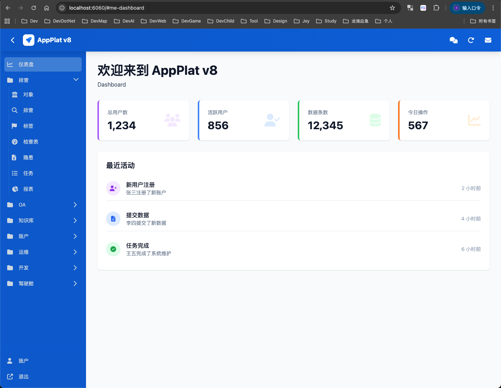
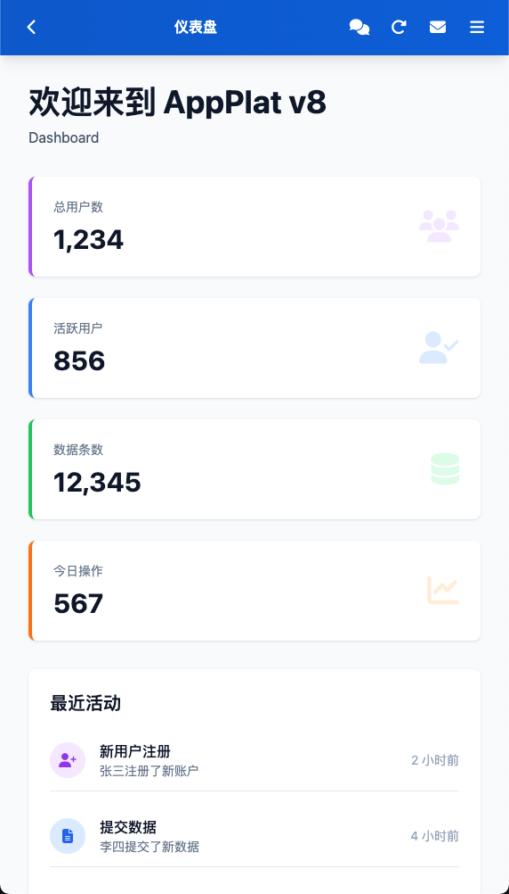
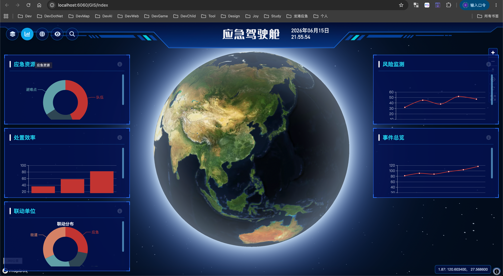
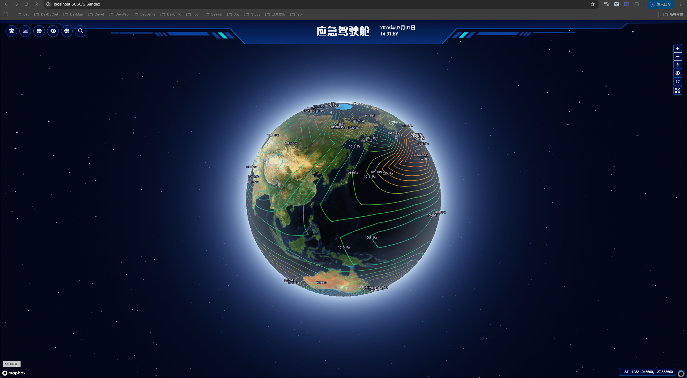
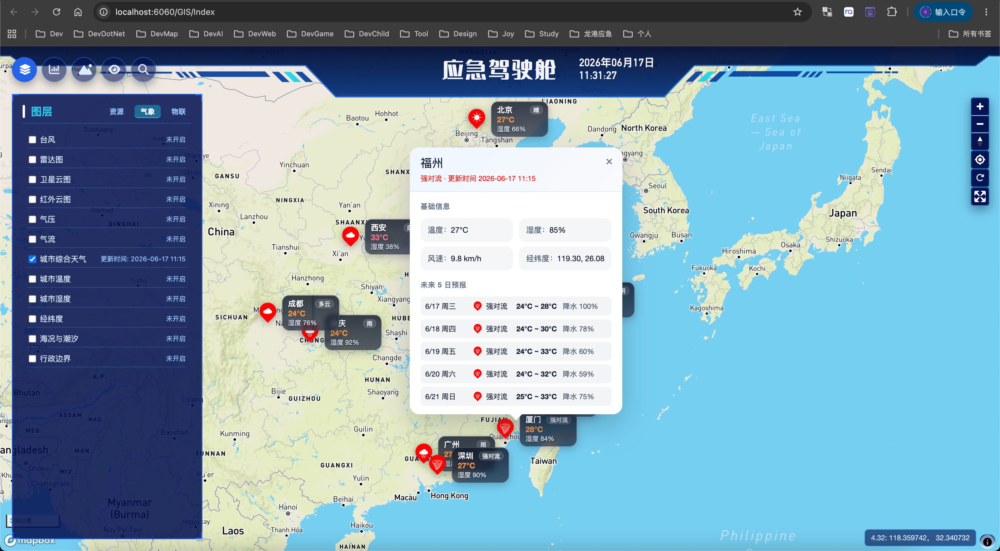

# AppPlat8

该系统是一个基于 .NET 8.0 的低代码 Web 应用开发平台，提供了以下功能：

- 用户管理：用户、角色、权限、组等。
- 运维：日志、菜单、在线等。
- OA：文章、资产、预算、项目、交办任务等。
- 驾驶舱：地图、图层、企业、区域、面板等。
- 隐患管理：对象、隐患、排查、任务、报表等。

内置以下开源方案

- EleUI 组件库：基于 Element Plus 、VUE3、tailwindcss 构建的 UI razor page 组件库。代码精简易用。详见 [EleUI 项目](./App.EleUI/README.md)。
- App.Entities ORM 框架：基于 EntityFramework 的数据实体 OR Mapping 方案。代码精简。详见 [App.Entities 项目](./App.Entities/README.md)。
- HttpApi ：提供 API 服务，用于前端调用，内置权限、异常、日志、文档、测试页面等功能；详见 [HttpApi 项目](./App.API/README.md)。
- LiteFlow 工作流引擎： 基于 App.LiteFlow 的工作流引擎的低代码工作流管理系统。详见 [App.LiteFlow 项目](./App.LiteFlow/README.md)。

作者

- 作者: https://github.com/surfsky
- 项目网址：https://github.com/surfsky/AppPlat8
- License: MIT

<!-- 图片路径必须严格大小写，因为 GitHub(Linux ext4) 大小写敏感，而 macOS APFS 默认不敏感：
     目录是 Doc/Images（I 大写），文件名全小写 gisglobal/cityweather -->







## 快速开始

1. 确保已安装 .NET 8 SDK。
2. 在 `appsettings.json` 中配置数据库连接。
3. 运行应用程序:

```bash

// 编译及运行# 编译并运行主项目（默认端口6001）
cd AppPlat
dotnet build
dotnet run --project App
dotnet run --project App/App.csproj --urls "http://172.20.165.221:6060"
dotnet app.dll --urls=http://localhost:6060;http://abc.org # 若端口被占用，查找并杀掉占用端口 6060 的进程

// 关闭进程
lsof -nP -iTCP:6060 -sTCP:LISTEN && lsof -ti tcp:6001 | xargs -n 1 kill -9
lsof -nP -iTCP:6060 -sTCP:LISTEN && lsof -ti tcp:6060 | xargs -n 1 kill -9
lsof -nP -iTCP:5000 -sTCP:LISTEN && lsof -ti tcp:5000 | xargs -n 1 kill -9

# 运行控制台项目（日常调度）
dotnet run --project app.consoler

// 编译及运行 EleUI 示例项目 # 编译EleUI示例项目
dotnet build App.EleUI/EleUISamples/EleUISamples.csproj
dotnet run --project App.EleUI/EleUISamples/EleUISamples.csproj
lsof -nP -iTCP:6070 -sTCP:LISTEN && lsof -ti tcp:6070 | xargs -n 1 kill -9  

// 编译及运行控制台项目 # 或 dotnet app.Consoler.dll --conn=Data Source=./App/Db/sqlite.db
dotnet run --project App.Consoler
```

4. 打开浏览器，访问 `http://localhost:6001` 或 `http://abc.org`。

## 测试

### 调试项目

- 若使用原生VSCode 环境，可以直接点左侧的调试标签图标（Bug图标），进行调试；
- 若使用三方网页，需安装三方调试插件：C# (with netcoredbg)，并点击页面右上角的调试图标，进行调试；

### 单元测试

```bash
    # 测试项目
    dotnet test App.Utils/App.UtilsTests/App.UtilsTests.csproj
    # 或点击左侧调试图标面板（烧瓶图标）进行调试，会细化到每一个方法的测试结果（含运行时间）
```

### 网页自动化测试

- 测试用例：在 WebTest 目录下的测试用例文件
- 测试环境：Selenium WebDriver

## 部署

### 文件部署方式

- 将/App目录下的所有文件复制到部署目录下。
- 配置数据库连接字符串：在部署目录下的 `appsettings.json` 文件中配置数据库连接字符串。
- dotnet app.dll --urls=http://localhost:6060;http://abc.org

### Docker 部署方式

- 应用程序目录：
- 数据库文件映射：
- 临时文件映射：

## 数据库迁移

1. 使用 EF 机制进行数据库迁移: 运行

```bash
   dotnet ef migrations add CheckObject --project App/App.csproj --startup-project App/App.csproj
```

## 数据备份

### 数据库备份：

- sqlite 数据库备份：直接拷贝一份到别地方就行
- 
- 
- postgresql 数据库备份：用 pg_dump 命令备份，用 pgagent 配置定时任务备份
- mysql 数据库备份：用 mysqldump 命令备份，用 mysqlbackup 配置定时任务备份

### 用户上传的文件备份：

- /App/Files/

## 项目目录说明

- App：主系统项目，包含业务逻辑、数据库访问、用户认证等功能。
- App.API: 提供 API 服务，用于前端调用，内置权限、异常、日志、文档、测试页面等功能。
- App.BLL: 业务逻辑层，包含业务逻辑实现，与数据库交互。
- App.Consoler: 控制台调度任务，用于后台任务调度，如数据清洗、备份、流程执行、消息推送等；
- App.EleUI: EleUI 组件库项目，包含 UI 组件的示例项目。
- App.Utils: 工具库项目，包含通用的工具类，如日期处理、字符串处理、加密等。
- App.Web: Web工具库项目，包含控制器、服务、缓存、权限等。
- Doc：文档目录，包含项目文档、用户手册、开发文档等。
- WebTest: Web 自动化测试相关代码。
- Temp：临时目录，用于存储临时文件，如测试日志、临时数据等。

## 进度

详见 [进度](./README-progress.md)

## 技术栈

详见 [技术栈](./README-stack.md)

## 主系统

详见 [主系统](./App/README.md)
